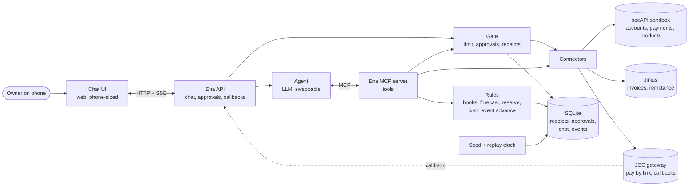
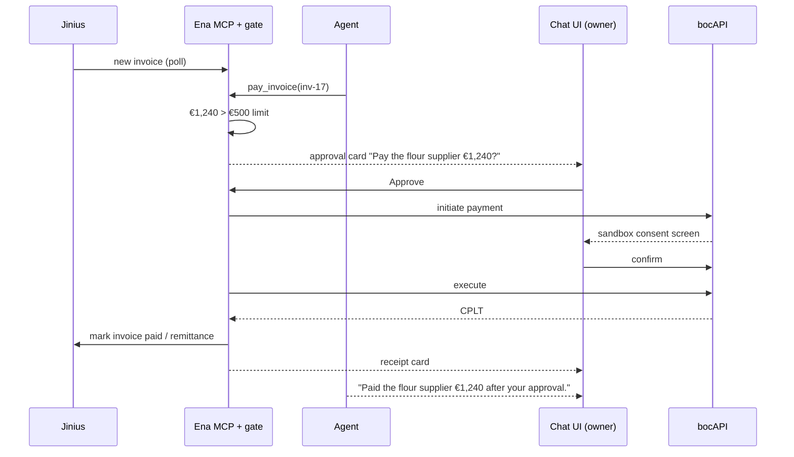
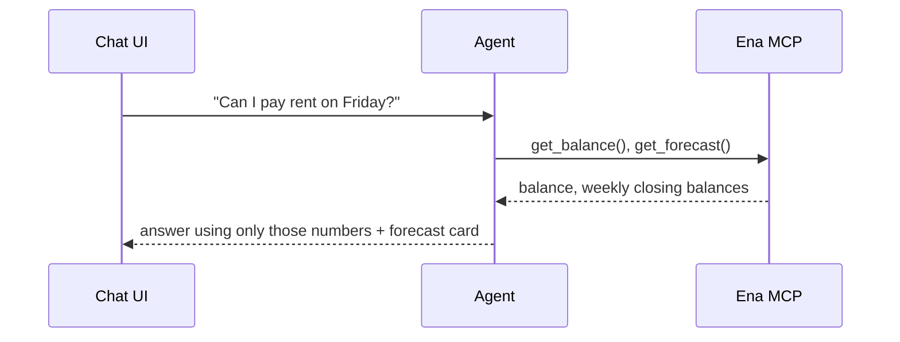
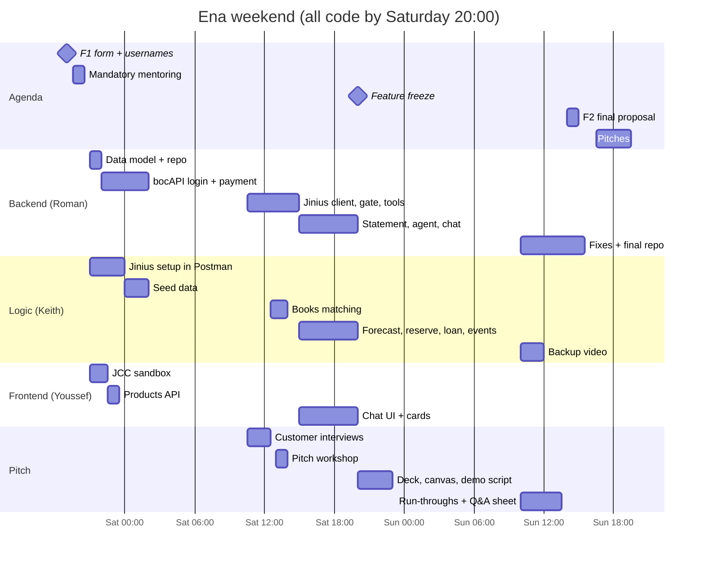

# Build plan: idea, architecture, tasks

A proposal for how we build Ena this weekend, written Fri 27 Nov 2026. Nothing here is decided until the team agrees; agreed points move to [plan.md](plan.md) with a date. Marked **ASSUMED** where we have not checked against the real APIs yet.

Contents: [1 Idea](#1-the-idea) · [2 Requirements](#2-requirements) · [3 Architecture](#3-architecture) · [4 Data model](#4-data-model) · [5 MCP tools](#5-mcp-tools-the-agents-api) · [6 The gate](#6-the-gate) · [7 Rules](#7-the-rules-code-decides) · [8 Chat](#8-chat-and-the-agent) · [9 Flows](#9-key-flows) · [10 Integrations](#10-integrations) · [11 Errors](#11-errors-retries-and-determinism) · [12 Stack and repo](#12-stack-and-repo-layout) · [13 Testing](#13-testing) · [14 Trade-offs](#14-trade-offs) · [15 Team and tasks](#15-team-and-tasks) · [16 Timeline](#16-timeline) · [17 Risks](#17-risks-and-fallbacks) · [18 After the hackathon](#18-what-we-would-revisit-after-the-hackathon) · [19 Open questions](#19-open-questions)

---

## 1. The idea

Ena is one AI agent for a micro-business's back office, on top of the owner's Bank of Cyprus account. The owner talks to Ena in a chat. Ena runs one loop:

| Step | What Ena does | Source |
|---|---|---|
| Supplier invoice | Receives the invoice and pays it | Jinius, bocAPI |
| Books | Matches payments and card sales | bocAPI, JCC |
| Cash forecast | Projects the coming weeks, flags a lean month | bocAPI |
| Credit offer | Sets money aside for instalments, offers a Digital Business Loan, or a short-term advance against a booked event (simulated: no lending API) | bocAPI Products API |

**The gate:** Ena pays on its own below the owner's limit, asks above it and leaves a receipt for every action.

**The demo scenario (one, end to end):** a synthetic business with a real-looking month. A supplier invoice arrives in Jinius; a small one is paid automatically; a large one becomes an approval card in the chat; the owner taps Approve; a real bocAPI sandbox payment executes; a card sale comes in through JCC and is booked; the forecast shows a lean week; Ena proposes a reserve or an advance and explains why in plain words. The owner can ask questions in the chat at any point.

---

## 2. Requirements

### Functional

| # | Requirement | Priority |
|---|---|---|
| F1 | Read new supplier invoices from Jinius | Must |
| F2 | Pay an invoice from the BoC account through the gate (auto below the limit, approval above) | Must |
| F3 | Receipt for every action, readable by the owner | Must |
| F4 | Book payments out and card/link sales in; show what is unmatched | Must |
| F5 | 8-week cash forecast that flags the lean week | Must |
| F6 | Reserve for the next loan instalment when a lean week comes before it | Must |
| F7 | Digital Business Loan offer, pre-filled, labelled simulated | Must |
| F8 | Owner chat: ask questions, get answers from real data, approve in the chat | Must |
| F9 | Short-term event advance for deposit-based businesses (caterer), from at least 10 past events | Should |
| F10 | Replay a synthetic month in about a minute for the demo | Must |

### Non-functional

| Concern | Target for the hackathon | Why |
|---|---|---|
| Correctness of money actions | No payment without passing the gate; every payment has exactly one receipt | The jury is a bank |
| Explainability | Every number the owner sees comes from code; the LLM only restates it | Organisers' guidance: AI explains, a person decides |
| Determinism | The stage run gives the same result every time (seeded data, cached replies) | No live debugging on stage |
| Latency | Chat answer starts streaming in under ~3 s; demo questions cached | A 5–6 minute pitch |
| Security | Secrets only in `.env`; the LLM never sees tokens; sandbox only | Rules and common sense |
| Scale | One business, one owner, one laptop | It is a demo; see §18 for a pilot |

### Constraints

- Coding stops Sun 29 Nov 15:30; about 30 build hours.
- Team: Roman (senior engineer), Keith and Youssef (juniors; Youssef also pitches).
- Built from scratch at the event, published under CC BY-SA 4.0 in the hackathon's GitHub organisation.
- bocAPI has no lending API; payments need a browser consent step (**ASSUMED** from earlier reading, verify on Friday).
- Jinius operations are known only after reading its six guides (task 1.2).

---

## 3. Architecture



### Components

| Component | Responsibility | Owner | Notes |
|---|---|---|---|
| Chat UI | Messages, streaming replies, cards (approval, receipt, forecast, offers), suggested-question chips | Youssef | One page, phone width |
| Ena API | HTTP for the UI: send message, stream reply (SSE), approve/decline, JCC callback | Roman | Thin; no business logic |
| Agent | Turns owner messages and events into tool calls; writes plain-language explanations | Roman | Swappable: anything that speaks MCP |
| Ena MCP server | The tools the agent may call (§5) | Roman | The only way the agent touches data or money |
| Gate | Limit check, approval queue, receipts, idempotency | Roman | Code, never the LLM |
| Rules | Pure functions: matching, forecast, reserve, loan amount, event pattern and advance | Keith | No I/O; tested on fixtures |
| Connectors | bocAPI, Jinius, JCC clients; map raw responses to the data model | Roman (Keith: Jinius research, Youssef: JCC, Products) | Raw responses saved to `fixtures/` |
| Store | SQLite: receipts, approvals, conversation, events, seeded data | Roman | One file, no server |
| Seed + replay | Synthetic business and month; accelerated clock | Keith (seed), Roman (replay) | Fixed random seed |

### Design principles

1. **Code decides, the LLM explains.** Limits, amounts, eligibility and forecasts are computed in `rules/` and `gate/`. The agent only passes on what tools return.
2. **One door for money.** Every payment, from the auto-pay loop or from a chat request, goes through `gate.request_payment`. No other code calls the payment connector.
3. **Fixtures first.** Juniors build against saved JSON responses; live calls replace them when they work. Nobody waits on the hardest integration.
4. **The loan never changes.** Relief is the owner's own reserve or a new advance/loan. Never "the bank defers an instalment" in code, UI or prompts.
5. **Synthetic and simulated are labelled** everywhere they appear.

---

## 4. Data model

One module (`ena/models.py`), written first by Roman (task 0.4). Amounts in euro cents as integers; dates ISO `YYYY-MM-DD` inside our code (bocAPI uses `dd/mm/yyyy`: convert in the connector).

| Entity | Fields | Notes |
|---|---|---|
| Business | id, name, sector, accountId, autoPayLimitCents, synthetic | One in the demo |
| Account | id, iban, balanceCents, currency | From bocAPI |
| Transaction | id, accountId, date, amountCents (+ in / − out), counterparty, reference | From the statement |
| SupplierInvoice | id, supplierName, supplierIban, amountCents, issueDate, dueDate, status (new / scheduled / awaiting_approval / paid / declined), jiniusId | Rename fields to match Jinius after 1.2 |
| CardSale | id, amountCents, date, jccOrderId, status | From JCC callback |
| Loan | id, instalmentCents, nextDueDate | Existing loan; read-only, never modified |
| Forecast | weeks[]: {weekStart, openingCents, inCents, outCents, closingCents}, leanWeek, reason | Output of rules |
| Event | id, customer, eventDate, priceCents, depositCents, costsCents, finalPaymentCents, status (booked / completed / cancelled) | For the event advance |
| Offer | id, kind (reserve / loan / event_advance), amountCents, termDays, basis (numbers used), simulated | Output of rules |
| ApprovalRequest | id, action, amountCents, reason, status (pending / approved / declined), createdAt, decidedAt | Created by the gate |
| Receipt | id, at, actor (ena / owner), action, amountCents, ref (invoice, payment, offer), result, explanation | Append-only |
| ChatMessage | id, at, role (owner / ena), text, cards[] | Conversation log |

---

## 5. MCP tools (the agent's API)

| Tool | Kind | Through the gate | Returns |
|---|---|---|---|
| `get_balance()` | read | — | Account balance |
| `list_transactions(from, to)` | read | — | Transactions |
| `list_unpaid_invoices()` | read | — | SupplierInvoices not paid |
| `get_books(period)` | read | — | Matched + unmatched (rules) |
| `get_forecast(weeks=8)` | read | — | Forecast (rules) |
| `get_event_pattern()` | read | — | Ratios from past events, or "fewer than 10 events" |
| `list_receipts(limit)` | read | — | Receipts |
| `pay_invoice(invoiceId)` | money | yes | `paid` + receipt, or `awaiting_approval` + approval id |
| `propose_reserve()` | money | yes | Offer, or none (rules decide) |
| `propose_loan()` | offer | receipt only | Offer, simulated |
| `propose_event_advance(eventId)` | offer | receipt only | Offer, simulated, or not eligible with the reason |
| `create_pay_link(amount, description)` | money in | receipt only | JCC link |

Rules for tools:
- Tools take ids, never amounts, for money actions: the amount always comes from the invoice or the rule, not from the LLM.
- There is no tool to change the limit or approve a request. Approval comes only from the owner's tap in the UI.

---

## 6. The gate

```text
request_payment(action, amount, ref):
  if a receipt already exists for ref     -> return it            (idempotency)
  if amount <= business.autoPayLimit      -> execute -> receipt(actor=ena)
  else                                    -> ApprovalRequest(pending) -> card in chat
on owner approve(approvalId):             -> execute -> receipt(actor=owner)
on owner decline(approvalId):             -> receipt(result=declined), invoice stays unpaid
execute: bocAPI initiate -> consent -> execute; result CPLT -> paid, else -> failed receipt
```

- Default limit comes from the interviews (question 7); placeholder €500.
- Every branch writes exactly one receipt; tests check this.
- The browser consent step of bocAPI (**ASSUMED**) happens once per payment in the sandbox. In the demo the owner's Approve tap is followed by the sandbox consent screen; we say so plainly.

---

## 7. The rules (code decides)

All pure functions in `ena/rules/`, inputs and outputs from §4, each with tests on fixed data.

**Books matching.** A payment matches an invoice when the amount is equal, the reference contains the invoice number or the counterparty matches the supplier, and the date is within 7 days of the due date. A card sale matches a deposit by JCC order id, or by amount and date within 3 days (settlement delay **ASSUMED**). Everything else is "unmatched" and shown to the owner.

**Forecast (8 weeks).**
`closing(week) = opening + expected card sales + known inflows − unpaid invoices due that week − rent − loan instalment due that week`
Expected card sales = average weekly card sales over the last 4 weeks. `leanWeek` = the first week whose closing balance is below the next instalment plus a buffer (placeholder: one week of average outflows).

**Reserve.** If `leanWeek` comes before the next instalment date, propose moving the instalment amount to a reserve account now. Goes through the gate like a payment.

**Digital Business Loan (simulated).** If the reserve cannot cover the gap: amount = gap rounded up to the next €500, at most €20,000, term up to 2 years (product limits from plan.md; recheck with the Products API in task 4.1).

**Event advance (simulated).** For deposit-based businesses:
1. From at least 10 completed events: deposit share of price, cost share of price, days before the event costs are paid, days after the event the final payment arrives, cancellation rate.
2. For a booked event: costs expected before the event minus the deposit minus spare cash = gap.
3. If gap > 0 and eligible (≥ 10 completed events, cancellations at most 1 in 10, **proposed**): advance = gap, due on the expected final-payment date, repaid from that payment through the gate.

Worked example (synthetic): €8,000 wedding, 25% deposit (€2,000), costs 60% (€4,800) paid 3–7 days before, spare cash €1,000 → gap €1,800 → advance €1,800 for 16 days, repaid from the €6,000 final payment.

---

## 8. Chat and the agent

- The owner's screen is a chat. Approvals, receipts, the forecast and offers appear as cards inside it, each with its buttons. Suggested-question chips sit under the input box.
- The agent gets: a system prompt with the answer rules, the MCP tools, and the conversation.
- Answer rules: every figure comes from a tool result in this turn; if no tool gives it, say "I don't know"; never promise a loan, say "offer, simulated"; reply in the owner's language (English or Greek).
- Agent runtime: the plan says swappable. **Proposal:** Claude through the Claude Agent SDK, which connects to MCP servers directly; Roman decides.
- Background work (new invoice arrives, replay clock ticks) runs the same loop without a chat message and posts its cards into the chat.

---

## 9. Key flows

### Pay an invoice above the limit



### Owner asks a question



---

## 10. Integrations

| API | What we use | How we get access | Status |
|---|---|---|---|
| bocAPI sandbox | OAuth2 client token, subscriptions (consent), accounts, balance, statement, payments initiate/execute, Products | Register at sandbox.bankofcyprus.com; Postman collections from the Technical Specifications | Endpoint groups VERIFIED (Tech Spec: `/oauth2`, `/psd2subscription`, `/psd2account`, `/psd2payments`, `/b2bpayments`); flow details ASSUMED |
| Jinius | Supplier invoices, mock payments, remittance | Integration environment; six guides at business.jinius.com.cy/support, read in order | Operations unknown until task 1.2 |
| JCC gateway | Pay by Link with a test card, callback | Self-service sandbox at gateway.jcc.com.cy/developer | Details unknown until task 2.1 |
| Products API (bocAPI) | Digital Business Loan product data | Same bocAPI app | ASSUMED available |

Notes carried from earlier reading of the BoC docs (ASSUMED, check on Friday): client token and user token are different, and execute needs the user token; consent screens are simulated with test credentials; docs' samples are inconsistent, so trust real responses; dates are `dd/mm/yyyy`.

---

## 11. Errors, retries and determinism

| Failure | Behaviour |
|---|---|
| Token expired | Connector refreshes once, then fails loudly |
| Payment not `CPLT` | Receipt with `failed`, invoice back to unpaid, card says so; no automatic retry of money actions |
| Duplicate trigger (replay or double tap) | Gate returns the existing receipt (idempotency on the invoice id) |
| Jinius or JCC down | Connector falls back to the saved fixture and the UI shows "sandbox offline, showing saved data" |
| LLM slow or down | Demo questions answered from the reply cache; other questions show "try again" |
| Agent asks for a number no tool gave | System prompt forbids it; test script (6.7) checks the demo questions |

**Determinism for the stage:** seeded data, fixed replay clock, cached replies for the demo questions, a recorded backup video.

---

## 12. Stack and repo layout

**Proposal; Roman decides** (one language for everything the juniors touch):

| Part | Proposal | Why |
|---|---|---|
| Server, MCP, rules | Python 3.12, FastAPI, the official MCP Python SDK, httpx, pydantic | Readable for juniors; rules are plain functions |
| Store | SQLite | One file, nothing to run |
| Tests | pytest | Fixtures as JSON files |
| Chat UI | Vite + React, one page | Fast to build; streaming via SSE |
| Agent | Claude through the Claude Agent SDK, MCP server attached | Swappable per plan.md |

```text
ena/
  models.py            data model (§4)
  connectors/          boc.py, jinius.py, jcc.py
  gate.py              limits, approvals, receipts
  rules/               books.py, forecast.py, reserve.py, loan.py, events.py
  mcp_server.py        tools (§5)
  api.py               chat, SSE, approve/decline, JCC callback
  agent.py             agent setup and answer rules
  seed.py, replay.py   synthetic month and clock
web/                   chat UI
fixtures/              boc/, jinius/, jcc/ saved responses
tests/                 one file per rules module + gate + tools
docs/                  plan, hackathon, interviews, this file, jinius-notes, jcc-notes
.env.example           names of the secrets, no values
```

---

## 13. Testing

- **Rules:** each function has tests with fixed inputs and exact expected outputs (Keith). Run on every pull request.
- **Gate:** below limit pays; above limit creates an approval; approve pays once; decline never pays; duplicate trigger returns the same receipt.
- **Connectors:** parse every saved fixture into the data model.
- **Chat:** 10 owner questions with expected answers from the seed data (task 6.7).
- **End to end:** the replay runs the whole month with no errors; run before every rehearsal.

---

## 14. Trade-offs

| Decision | Chosen | Alternative | Why |
|---|---|---|---|
| Who decides money | Code (gate + rules) | LLM with guardrails | Bank jury; explainability; organisers ask for a person in the loop |
| Agent interface | MCP server | Direct function calls in one app | "The gate works with any agent"; one more client (e.g. IBM) is an hour's work. Cost: one more process |
| Owner interface | Chat with cards | Separate dashboard screens | One surface for questions and approvals; fewer pages to build. Risk: chat feels slow if the LLM is slow → cache |
| Store | SQLite | Postgres | Nothing to run on stage |
| Forecast | Simple weekly arithmetic | ML model | A banker can follow it; no training data |
| Juniors' work | Pure functions on fixtures | Pair on live integrations | Nobody blocks on bocAPI consent; easy to test |
| Loan step | Simulated, labelled | Fake a lending API | Honest; the sandbox has none |
| Event advance | Should, not Must | In the core loop | Adds ~6 h; only if the loop works by Saturday afternoon |

---

## 15. Team and tasks

**Roman (senior):** everything that calls a live API or moves money: data model, connectors, gate, MCP server, agent, chat endpoint, replay, integration, reviews.
**Keith (junior):** pure logic and data: Jinius research tonight, seed data, books matching, forecast, reserve, loan and event rules, chat test script, backup video.
**Youssef (junior, on stage):** JCC sandbox and Products API tonight, the chat UI and its cards, interviews, deck, pitch, F1/F2.

Juniors build against `fixtures/`, every function has a test, small pull requests reviewed by Roman, ask after 30 minutes stuck.

| Area | Tasks | Owner | Hours |
|---|---|---|---|
| Now | F1 form, GitHub usernames, ask about demo/Q&A timing | Youssef | — |
| Foundation | Data model, repo, `fixtures/` | Roman | 1 |
| bocAPI | Login + consent, payment to `CPLT`, statement | Roman | 5 |
| Jinius | Guides 1–6 in Postman, notes, test invoices | Keith | 3 |
| Jinius | Client, mark paid | Roman | 2 |
| JCC | Sandbox, test payment, callback sample | Youssef | 1.5 |
| JCC | Callback endpoint | Roman | 1 |
| Gate | Limit, approvals, receipts, idempotency | Roman | 2 |
| Rules | Matching, forecast, reserve, loan | Keith | 7.5 |
| Event advance (Should) | Seed events, detection, pattern, advance rule | Keith | 6 |
| Event advance | Repayment through the gate, explanation | Roman | 1.5 |
| Products | Digital Business Loan product data | Youssef | 1 |
| Agent + chat | MCP server, agent, chat endpoint, answer rules, cache | Roman | 8 |
| Chat UI | Messages, streaming, cards, chips | Youssef | 3.5 |
| Data | Seed month, replay clock | Keith, Roman | 4 |
| Tests | Chat test script | Keith | 1 |
| Pitch | Interviews, workshop, deck, canvas, demo script, video, run-throughs | Youssef, Keith | Sat/Sun |

Load: Roman ~21 h + reviews, Keith ~17 h with the event advance (~11 h without), Youssef ~6 h build + pitch. Roman is the bottleneck: if Saturday 15:00 arrives with the payment not working, cut the event advance and the reply cache first.

---

## 16. Timeline



Checkpoints:
- **Fri 23:59:** one bocAPI sandbox payment reaches `CPLT`; Jinius call works in Postman; JCC test payment done.
- **Sat 15:00:** gate + Jinius + payment work end to end on one invoice. If not, cut the event advance.
- **Sat 20:00:** feature freeze. The replay runs the month.
- **Sun 12:00:** backup video recorded; F2 drafted.

---

## 17. Risks and fallbacks

| Risk | Likelihood | Fallback |
|---|---|---|
| bocAPI payment consent cannot be automated | Medium | Approve tap → sandbox consent screen shown on stage as "the bank's own confirmation" |
| Jinius has no usable invoice or remittance operations | Medium | Mock with the same shape as their responses, say so on stage |
| Roman overloaded | High | Cut order: event advance → reply cache → books matching to amounts only |
| LLM latency or outage on stage | Medium | Cached demo replies; backup video |
| Venue network fails | Medium | Fixtures + cached replies + video |
| Interviews give no numbers | Low | Keep placeholder numbers, label them as such |
| Too many features for 5–6 minutes | High | One scenario; the event advance is 20 seconds or cut |

---

## 18. What we would revisit after the hackathon

- **Real consent model:** per-payment consent vs a standing mandate within the owner's limit (PSD2, BoC's own rules).
- **Multi-tenant store:** Postgres, per-business encryption, audit log retention.
- **Lending:** a real BoC lending API, credit policy and affordability checks instead of our simple rules.
- **Forecast quality:** backtest on real anonymised accounts; seasonality; error rates shown.
- **Agent safety:** red-team prompts, rate limits on money tools, monitoring of every tool call.
- **Scale:** event-driven invoice intake (webhooks instead of polling), queue for payments.

---

## 19. Open questions

1. Is this split agreed by Roman and Keith?
2. Language and framework: Roman's call (§12 is a proposal).
3. Agent runtime for the demo (§8).
4. Demo business: bakery, or a caterer that also shows the event advance?
5. Event advance: Must or Should? Cancellation limit for eligibility?
6. Ask the BoC lending mentor: is the event advance a new product or a use of the Digital Business Loan?
7. Do the 5–6 pitch minutes include the demo and Q&A?
