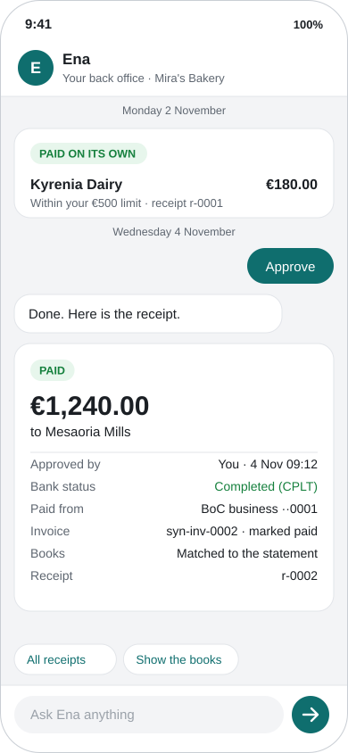
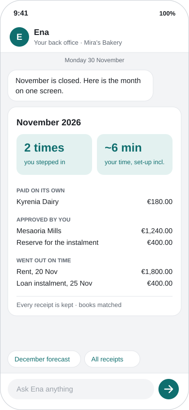

# Mockups of the owner's screens

The owner's side of Ena is one chat at phone width; approvals, receipts, the forecast and offers arrive in it as cards ([build-plan.md](../build-plan.md) §8). These five screens walk through the synthetic month of a bakery, in the order of [plan.md](../plan.md)'s owner journey. The amounts come from the seed ([ena/seed.py](../../ena/seed.py)) and the forecast and offer rules run on it; they change when the seed changes. The bakery's name is made up.

| Screen | What the owner sees |
|---|---|
| [1. Approval above the limit](1-approval.svg) | A notification and the card for the €1,240 flour invoice, above the €500 limit: Approve or Not now |
| [2. Receipts](2-receipts.svg) | The €180 dairy invoice paid on its own, then the receipt for the approved €1,240 payment |
| [3. Cash forecast](3-forecast.svg) | Eight weeks of closing balances; the week of 16 November falls to €372.57, below the €950 safe line |
| [4. Credit offer](4-credit-offer.svg) | Set €400 aside for the 25 November instalment, or a pre-filled €1,000 Digital Business Loan, marked simulated |
| [5. Month end](5-month-end.svg) | November on one screen: the owner stepped in twice, about 6 minutes of their time with set-up |

    
