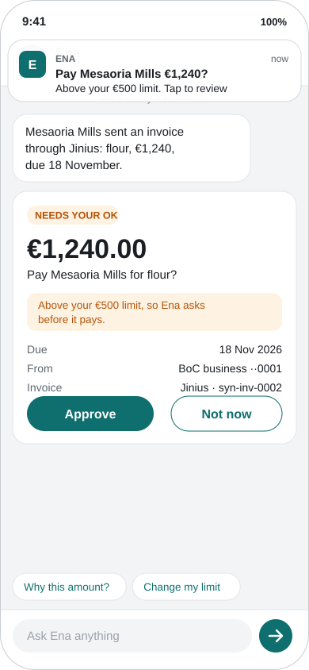
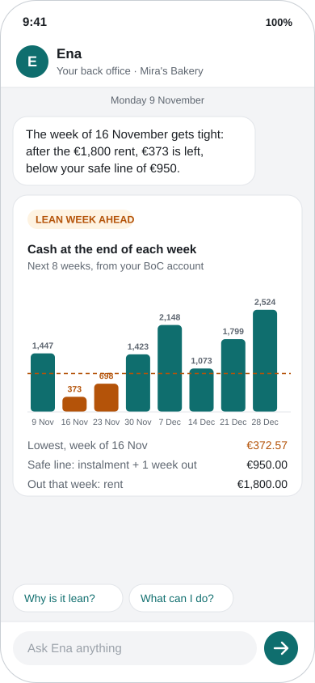
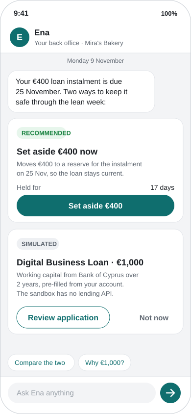
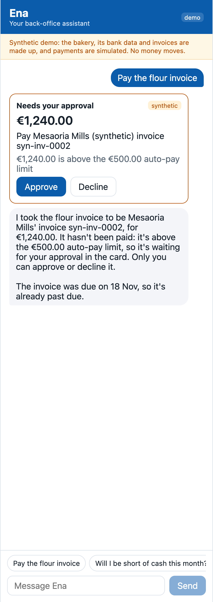
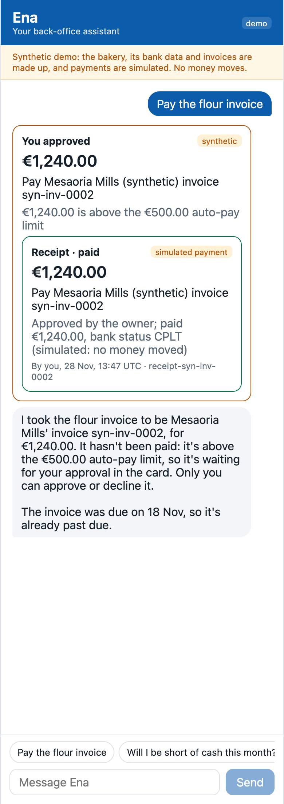
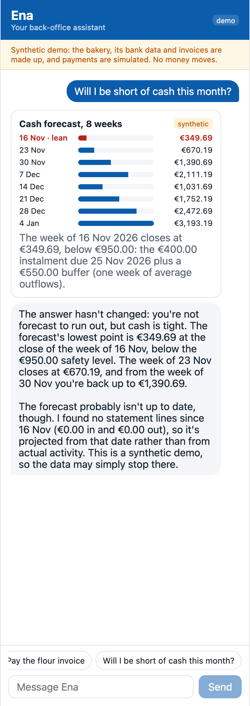
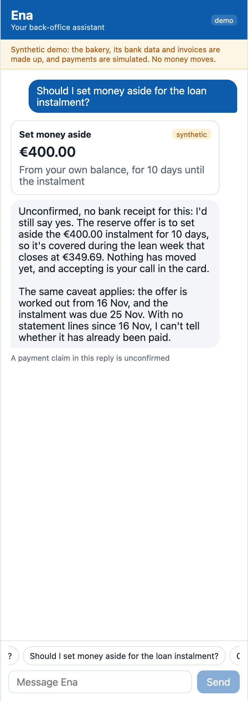
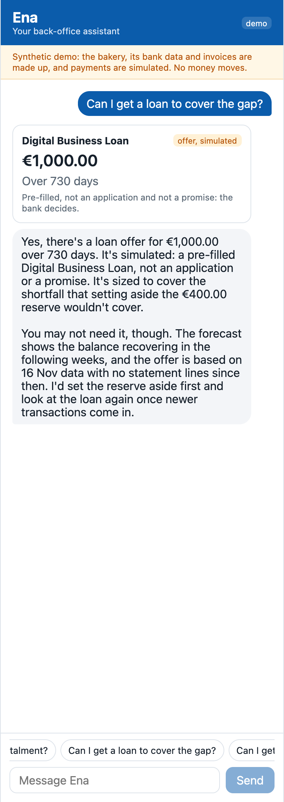

# Mockups of the owner's screens

The owner's side of Ena is one chat at phone width; approvals, receipts, the forecast and offers arrive in it as cards ([build-plan.md](../build-plan.md) §8). These five screens walk through the synthetic month of a bakery, in the order of [plan.md](../plan.md)'s owner journey. The amounts come from the seed ([ena/seed.py](../../ena/seed.py)) and the forecast and offer rules run on it; they change when the seed changes. The bakery's name is made up.

| Screen | What the owner sees |
|---|---|
| [1. Approval above the limit](1-approval.svg) | A notification and the card for the €1,240 flour invoice, above the €500 limit: Approve or Not now |
| [2. Receipts](2-receipts.svg) | The €180 dairy invoice paid on its own, then the receipt for the approved €1,240 payment |
| [3. Cash forecast](3-forecast.svg) | Eight weeks of closing balances; the week of 16 November falls to €372.57, below the €950 safe line |
| [4. Credit offer](4-credit-offer.svg) | Set €400 aside for the 25 November instalment, or a pre-filled €1,000 Digital Business Loan, marked simulated |
| [5. Month end](5-month-end.svg) | November on one screen: the owner stepped in twice, about 6 minutes of their time with set-up |

    

## Screenshots of the running app

The same screens in the chat page as it runs today (`uv run ena-serve` with the synthetic month as of 16 November, and [web/](../../web/)), at 390 px phone width, with Ena's replies from the model. Every card comes from Ena's tools, the gate and the stand-in bank; the approval's receipt is a simulated payment, and no money moved. Taken on 28 November 2026, in one chat session, the flour invoice approved last. The model's replies still mix up the demo's day with the real date: they call the data stale since 16 November and the flour invoice past due, and the reserve reply carries the page's "unconfirmed" note; retake them once the agent is told the business day.

| Screenshot | Day of the month | What it shows |
|---|---|---|
| [1. Approval](screens/1-chat-approval.png) | 16 November | "Pay the flour invoice": the €1,240.00 Mesaoria Mills invoice, above the €500.00 limit, with Approve and Decline |
| [2. Receipt](screens/2-chat-receipt.png) | 16 November | After Approve: the receipt for the simulated payment, bank status `CPLT` |
| [3. Cash forecast](screens/3-chat-forecast.png) | 16 November | "Will I be short of cash this month?": eight weeks; the week of 16 November closes at €349.69, below €950.00 |
| [4. Reserve](screens/4-chat-reserve.png) | 16 November | "Should I set money aside for the loan instalment?": €400.00 for the 25 November instalment |
| [5. Loan offer](screens/5-chat-loan.png) | 16 November | "Can I get a loan to cover the gap?": a pre-filled €1,000.00 Digital Business Loan over 730 days, marked offer, simulated |

    
